# MiniCache: High-Performance In-Memory Key-Value Store

<p align="center">
  
</p>

<p align="center">
  <a href="#one-command-quickstart"></a>
  &nbsp;
  
  &nbsp;
  
  &nbsp;
  
  &nbsp;
  
  &nbsp;
  <a href="LICENSE"></a>
</p>

> A lightweight, standalone, in-memory caching daemon built entirely from first principles in Java 21 with zero third-party dependencies. Speaks the Redis Serialization Protocol (RESP) over raw TCP sockets, featuring a custom separate-chaining hash table, sentinel-based $O(1)$ LRU queue eviction, absolute 64-bit epoch TTLs, and a multi-threaded connection server.

---

## One-Command Quickstart

MiniCache requires zero build tools (`no Maven`, `no Gradle`) and zero external libraries. All you need is **JDK 21+**.

### Single-Line Launch
```bash
git clone https://github.com/logicbyabhinav/MiniCache.git && cd MiniCache && javac -d bin -sourcepath src src/com/minicache/*.java src/com/minicache/engine/*.java src/com/minicache/command/*.java src/com/minicache/server/*.java && java -cp bin com.minicache.MiniCache
```

### Or Use the Included Launch Scripts
* **Windows**:
  ```cmd
  run.bat
  ```
* **Linux / macOS**:
  ```bash
  chmod +x run.sh && ./run.sh
  ```

MiniCache will bind to TCP port **6379**. Connect using any standard Redis client or telnet:
```bash
redis-cli -p 6379
```
```text
127.0.0.1:6379> PING
PONG
127.0.0.1:6379> SET user abhinav EX 60
OK
127.0.0.1:6379> GET user
"abhinav"
```

---

## Architectural Topology: The Cache-Aside Pattern

MiniCache lives directly alongside your primary database to serve repetitive reads in nanoseconds from volatile RAM:

```
[ Web Client / Microservice ]
              │
              │  HTTP / RPC
              ▼
┌────────────────────────────────────────────────────────┐
│      Application Server (Node.js / Python / Go)        │
│   • Authenticates requests & executes business logic   │
└───────────────┬────────────────────────┬───────────────┘
                │                        │
       (1) Fast Cache Query              │ (3) DB Query on Cache Miss
           (Sub-millisecond)             │     (~15ms disk fetch)
                ▼                        ▼
    ┌───────────────────────┐   ┌────────────────────────┐
    │       MiniCache       │   │    Primary Database    │
    │   (Java TCP Daemon)   │   │  (PostgreSQL / SQLite) │
    │   Port: 6379          │   │  Durable Disk Storage  │
    └───────────────────────┘   └────────────────────────┘
```

---

## The 3-Pillar Streamlined Architecture

MiniCache is organized into three strictly decoupled pillars:

```
                               +---------------------------------+
                               |          MiniCache.java         |
                               |    (Bootstrap Orchestration)    |
                               +---------------------------------+
                                                |
                                                v
+-----------------------------------------------------------------------------------------------+
| PILLAR 1: SERVER (Network Transport Layer) : com.minicache.server                             |
| - MiniCacheServer.java                                                                        |
|   • Binds to TCP port 6379 via ServerSocket.                                                  |
|   • Dedicated Acceptor loop dispatches connections to an ExecutorService thread pool.          |
|   • Manages per-client socket streams (BufferedReader / PrintWriter with auto-flush).         |
+-----------------------------------------------------------------------------------------------+
                                                |
                                                v
+-----------------------------------------------------------------------------------------------+
| PILLAR 2: COMMAND (Protocol & Dispatcher Layer) : com.minicache.command                       |
| - CommandHandler.java                                                                         |
|   • Splits raw lines into command tokens via whitespace regex (\\s+).                         |
|   • Enforces arity & syntax validation (PING, SET, GET, DEL, EXISTS).                         |
|   • Serializes outputs into standard Redis RESP wire protocol (+OK, $len, :int, -ERR, $-1).   |
+-----------------------------------------------------------------------------------------------+
                                                |
                                                v
+-----------------------------------------------------------------------------------------------+
| PILLAR 3: ENGINE (Core Data Store & Eviction Layer) : com.minicache.engine                    |
| - CacheObject.java : Raw data envelope, 64-bit epoch deadlines, access timestamps.           |
| - CacheMap.java    : Custom separate-chaining hash table with polynomial rolling hash.        |
| - CacheEngine.java : Thread-safe policy controller, O(1) LRU eviction, and lazy TTL pruning.  |
+-----------------------------------------------------------------------------------------------+
```

---

## O(1) LRU Eviction with Sentinel Nodes

When capacity is reached, MiniCache evicts the least-recently used key in strict $O(1)$ time without searching or scanning arrays:

<p align="center">
  
</p>

* **Sentinels (`head` and `tail`)**: Guard boundaries ensure insertions and deletions execute in zero boundary null-checks.
* **Direct Reference Pointer Hook**: `CacheObject` holds a direct reference to its `Node` in the LRU queue. Access promotion during `get()` requires **zero hash lookup hops**.

---

## Supported RESP Protocol Commands

MiniCache is wire-compatible with Redis 2.0+ specifications:

| Command | Syntax | Success Return | Error / Miss Return | Wire Description |
| :--- | :--- | :--- | :--- | :--- |
| **`PING`** | `PING [msg]` | `+PONG\r\n` or `$<len>\r\n<msg>\r\n` | `-ERR wrong number of arguments...` | Heartbeat & connection check |
| **`SET`** | `SET <k> <v> [EX sec]` | `+OK\r\n` | `-ERR syntax error` / `-ERR value...` | Stores key with optional TTL |
| **`GET`** | `GET <k>` | `$<len>\r\n<val>\r\n` | `$-1\r\n` (Null Bulk String) | Fetches value; promotes in LRU |
| **`DEL`** | `DEL <k>` | `:1\r\n` (if deleted) | `:0\r\n` (if absent) | Unlinks from hash table & LRU |
| **`EXISTS`**| `EXISTS <k>` | `:1\r\n` (if present) | `:0\r\n` (if absent/expired) | Probes key without LRU promotion |

---

## Architectural Decision Records (ADRs)

Every design choice is formally documented with context, alternatives, and trade-offs in [ENGINEERING_DECISIONS.md](ENGINEERING_DECISIONS.md):

* **[ADR-001](ENGINEERING_DECISIONS.md#adr-001-project-layering--the-3-pillar-architecture-vs-deep-micro-package-modularization)**: The 3-Pillar Architecture vs. Deep Modularization
* **[ADR-002](ENGINEERING_DECISIONS.md#adr-002-data-envelope-design--cacheobject-attributes-and-memory-representation)**: Data Envelope Attributes & Memory Representation
* **[ADR-003](ENGINEERING_DECISIONS.md#adr-003-ttl-expiration-policy--absolute-timestamp-deadlines-vs-relative-offsets)**: Absolute 64-Bit Epoch Deadlines vs. Relative Offsets
* **[ADR-004](ENGINEERING_DECISIONS.md#adr-004-memory-safety--fail-fast-validation-vs-silent-sanitization)**: Fail-Fast Key Validation vs. Silent Fallback
* **[ADR-005](ENGINEERING_DECISIONS.md#adr-005-ttl-pruning-mechanisms--active-background-sweeping-vs-lazy-on-access-eviction)**: Lazy On-Access Pruning vs. Active Background Sweeping
* **[ADR-006](ENGINEERING_DECISIONS.md#adr-006-custom-hash-table-architecture--primitive-array--separate-chaining-vs-built-in-concurrenthashmap)**: Custom Separate Chaining Hash Table vs. `ConcurrentHashMap`
* **[ADR-007](ENGINEERING_DECISIONS.md#adr-007-hash-distribution-algorithm--polynomial-rolling-hash-vs-identity-hash)**: Polynomial Rolling Hash ($p=31$) vs. `Object.hashCode()`
* **[ADR-008](ENGINEERING_DECISIONS.md#adr-008-bitwise-index-masking-vs-modulo-arithmetic)**: Bitwise Index Masking vs. Modulo Arithmetic
* **[ADR-009](ENGINEERING_DECISIONS.md#adr-009-cacheobject-immutability-vs-mutable-payloads)**: CacheObject Immutability vs. Mutable In-Place Payloads
* **[ADR-010](ENGINEERING_DECISIONS.md#adr-010-thread-safety-model--synchronized-monitors-vs-readwritelocks)**: Synchronized Monitors vs. ReadWriteLocks
* **[ADR-011](ENGINEERING_DECISIONS.md#adr-011-pointer-containment--intrusive-pointers-in-cacheobject-vs-external-node-carriages)**: Non-Intrusive Separation: "Books cannot make a shelf"
* **[ADR-012](ENGINEERING_DECISIONS.md#adr-012-decoupling-hash-collisions-from-lru-queuing--node-vs-store)**: Decoupling Hash Collisions from LRU Queuing (`Store` vs. `Node`)
* **[ADR-013](ENGINEERING_DECISIONS.md#adr-013-chasing-pointer-deletion--atomic-removal-vs-lookup-then-delete)**: Chasing Pointer Deletion with Pop-Style Semantics
* **[ADR-014](ENGINEERING_DECISIONS.md#adr-014-o1-lru-eviction-via-doubly-linked-list-with-sentinels--coordinated-lazy-expiration)**: $O(1)$ LRU Eviction via Doubly Linked List with Sentinels
* **[ADR-015](ENGINEERING_DECISIONS.md#adr-015-redis-serialization-protocol-resp-parser--length-prefixed-framing-architecture)**: RESP Length-Prefixed Framing & Binary Safety
* **[ADR-016](ENGINEERING_DECISIONS.md#adr-016-multi-threaded-tcp-serversocket--graceful-lifecycle-architecture)**: Multi-Threaded TCP ServerSocket & Graceful Shutdown Hooks

---

## Automated Verification & Test Suite

MiniCache contains end-to-end integration test harnesses verifying hash collisions, sentinel pointers, LRU promotion, lazy TTL eviction, RESP wire framing, and multi-client socket concurrency:

```bash
# Run Core Engine Tests (LRU Eviction + TTL Expiration + Hash Collisions)
javac -d bin -sourcepath src -cp bin test/TestEngine.java && java -ea -cp bin test.TestEngine

# Run Protocol & Command Tests (RESP Formatting + Edge Cases)
javac -d bin -sourcepath src -cp bin test/TestCommandHandler.java && java -ea -cp bin test.TestCommandHandler

# Run Live Multi-Threaded TCP Socket Tests (Concurrent Client Threads)
javac -d bin -sourcepath src -cp bin test/TestLiveServer.java && java -ea -cp bin test.TestLiveServer
```

---

## GitHub Repository Topics

Recommended tags for this repository:
`cache` · `redis` · `resp-protocol` · `java21` · `systems-programming` · `in-memory-database` · `lru-cache` · `tcp-sockets` · `data-structures` · `zero-dependencies`

---

## Roadmap & Future Versions

MiniCache's forward engineering path is documented in **[ROADMAP.md](ROADMAP.md)**:
* **v1.1.0**: Multi-line RESP 2 Array Parser (`*<count>\r\n`), active background TTL sweeping, and counter primitives (`INCR`/`DECR`/`MGET`/`MSET`).
* **v1.2.0**: Durability via Append-Only File (AOF) write-ahead logging, `fsync` policies, and background compaction (`BGREWRITEAOF`).
* **v1.3.0**: Rich collection primitives: Doubly-linked Lists, embedded Hash Maps, and Sets.
* **v2.0.0**: Non-blocking Java NIO Reactor architecture (`Selector` event loop) and pipelining benchmarked against `redis-benchmark`.

---

## License

Released under the **[MIT License](LICENSE)**. Copyright (c) 2026 Abhinav Kishore.
